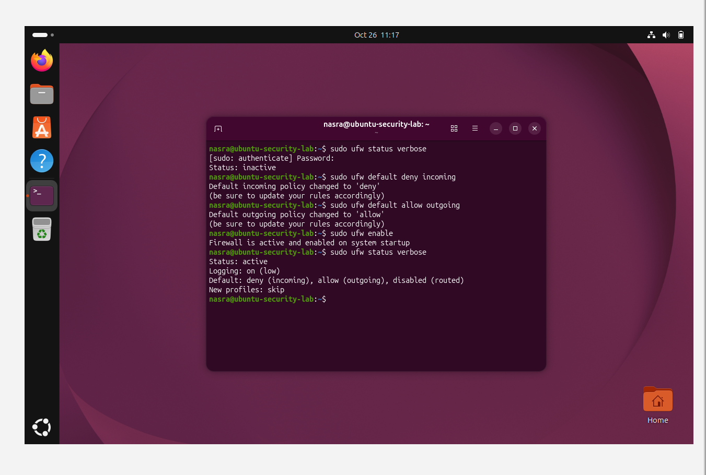
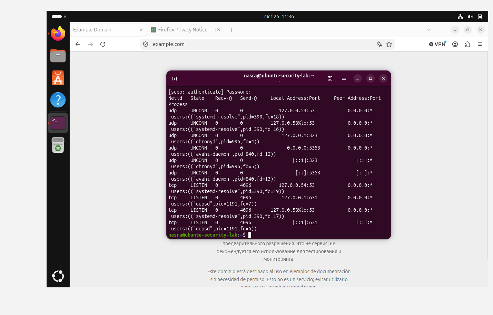
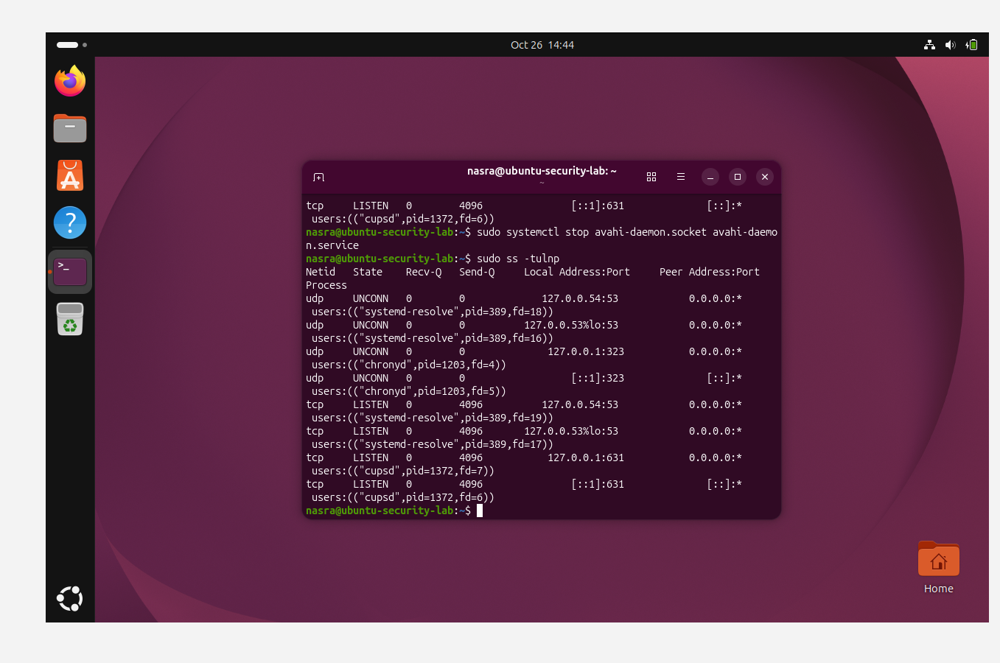
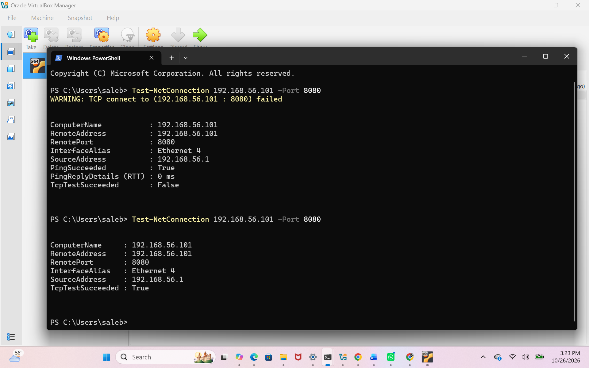
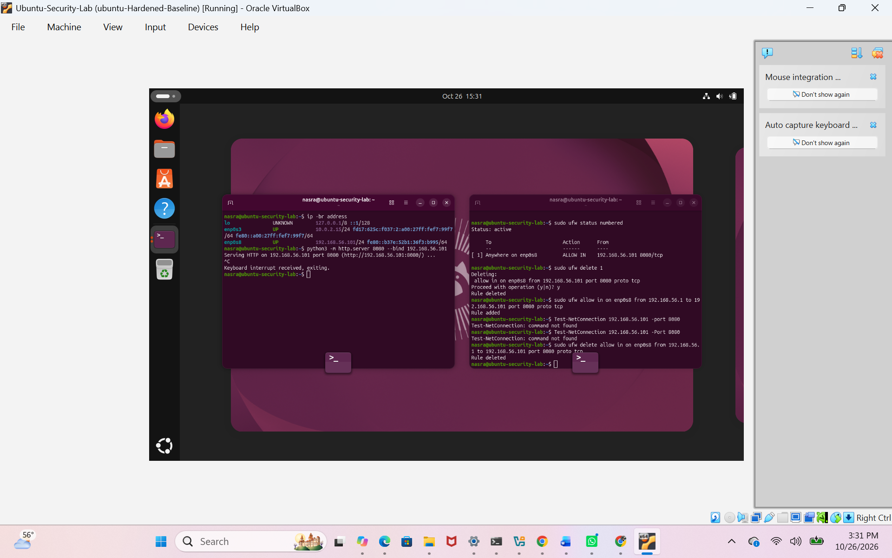

# Ubuntu Security Home Lab

## Project Overview

In this project, I created an Ubuntu virtual machine using VirtualBox and practiced basic security hardening, firewall configuration, and network testing.

## Tools Used

- Ubuntu Linux
- Oracle VirtualBox
- UFW firewall
- Windows PowerShell
- Python HTTP server

## What I Did

1. Created an Ubuntu virtual machine and configured its network connection.
2. Updated the system and enabled the UFW firewall.
3. Set the firewall to deny incoming connections and allow outgoing connections by default.
4. Reviewed listening ports and stopped the Avahi service to reduce unnecessary network exposure.
5. Reviewed sudo activity in system logs.
6. Created a VirtualBox snapshot of the hardened baseline.
7. Added a host-only network adapter to test connections between Windows and Ubuntu.

## Firewall Test

I started a temporary web server on Ubuntu using TCP port 8080 and tested the connection from Windows.

- **Before the allow rule:** The connection failed.
- **After the allow rule:** The connection succeeded.
- **Cleanup:** I removed the temporary rule and stopped the web server.

The allow rule was limited to the Windows host and the Ubuntu host-only interface.

## What I Learned

- How to set up and use a virtual machine.
- How to configure and review firewall rules.
- How to identify listening network services.
- How to test a network connection between Windows and Ubuntu.
- How to use system logs and snapshots during a security lab.

## Screenshots and Evidence

### Firewall configuration
UFW is active, with incoming connections denied and outgoing connections allowed by default.

### Listening services before and after
I reviewed listening services, then stopped Avahi and checked the list again.

**Before:**

**After:**

### Firewall connection test
The Windows connection test failed before the temporary allow rule and succeeded after the rule was added.

### Cleanup
After testing, I removed the temporary firewall rule and stopped the test server.

